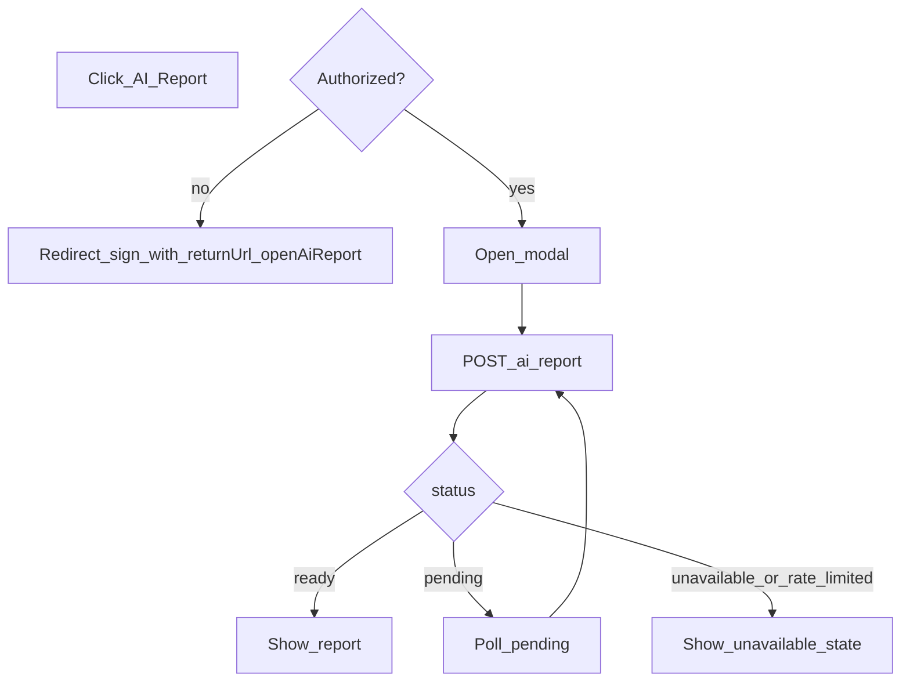

# AI-отчёт по объявлению (PPCSL / kupito.club)

Спецификация для разработки и для настройки промптов: не чат, один структурированный отчёт на связку **объявление + язык отчёта + актуальность входных данных**, быстрый UX на странице объявления.

**Точки входа в коде (реализация позже):** клиент страницы объявления — [`core/frontend/app/listings/[id]/ListingPageClient.tsx`](../../frontend/app/listings/[id]/ListingPageClient.tsx), хук [`useListingPageClient.ts`](../../frontend/app/listings/[id]/useListingPageClient.ts). Стиль соседних карточек и ссылок на API — по аналогии с [`infocar-history-section.md`](./infocar-history-section.md).

---

## 1. Цели и границы продукта

- **Не чат:** пользователь не ведёт диалог с моделью.
- **Один отчёт** на объявление в смысле кэша: при неизменных «важных» данных объявления и том же языке отчёта повторно вызывается сохранённый результат, а не новая генерация.
- **Фиксированный формат** блоков в UI и в JSON от модели.
- **Быстрый UX:** один явный жест (кнопка), далее модалка с готовым текстом или состоянием ожидания / недоступности.

---

## 2. MVP: что входит и что не входит

### Входит в MVP

- Кнопка на странице объявления (только **автомобильные** объявления, см. ниже).
- Модалка с отчётом и состояниями загрузки / ошибки «функция недоступна».
- Генерация через Gemini, кэширование, глобальная дедупликация параллельных генераций.
- Доступ только для **авторизованных** пользователей; гость → вход/регистрация с возвратом на объявление и **однократным** автооткрытием отчёта.
- Языки отчёта в MVP: **румынский (`ro`)** и **русский (`ru`)**.

### Не входит в MVP

- Анализ фотографий.
- VIN и внешняя история автомобиля.
- Внешние источники данных (кроме текста/полей самого объявления и общих знаний модели).
- Персонализация под профиль пользователя (кроме языка и лимитов).

### Категория объявления

- В домене объявлений есть `category`: `vehicle` | `tire` (см. [`tires-category.md`](./tires-category.md)).
- **В MVP кнопку «AI-отчёт» показывать только при `category === 'vehicle'`** (или при отсутствии поля в старых данных — трактовать как `vehicle`). Для `category === 'tire'` кнопку **не показывать**; отдельная спецификация для шин — позже.

---

## 3. Доступ, редирект и автооткрытие

### Авторизация

- Фича **только для авторизованных** пользователей.
- **Гость** при нажатии на кнопку: перенаправление на поток входа или регистрации с сохранением намерения открыть отчёт.

### Возврат на объявление

- Использовать существующий механизм **`returnUrl`** и санитизацию URL (как на логине/регистрации: [`core/frontend/app/login/useLoginPage.ts`](../../frontend/app/login/useLoginPage.ts), [`useRegisterPage.ts`](../../frontend/app/register/useRegisterPage.ts), complete-profile).

### Автооткрытие модалки один раз после входа

**Выбранный вариант:** query-параметр в URL объявления после возврата, например `openAiReport=1`.

- При клике гостя на «AI-отчёт» в `returnUrl` передаётся путь к текущему объявлению **с** `openAiReport=1` (в дополнение к существующим query, если есть).
- После успешной авторизации и возврата на PDP клиент **один раз** открывает модалку и **сразу** удаляет параметр из адреса (`replaceState` / навигация без параметра), чтобы повторное обновление страницы не открывала модалку снова.
- Альтернатива `sessionStorage` не используется в MVP, чтобы поведение было прозрачным при шаринге ссылки и отладке.

---

## 4. UX и UI

### Подписи кнопки (i18n)

| Локаль UI (пример) | Текст кнопки |
|--------------------|--------------|
| `ru`               | AI-отчёт     |
| `ro`               | Raport AI    |

Рекомендуемые ключи сообщений (реализация): `listingDetail.aiReport` / `listingDetail.aiReportShort` — согласовать с текущей схемой `listingDetail.*` в `locales/*.json`.

### Поведение по шагам

1. Пользователь нажимает кнопку.
2. Если **не авторизован** → редирект на вход/регистрацию с `returnUrl` на объявление с `openAiReport=1`.
3. После возврата → **однократное** автооткрытие (п.3).
4. Если **авторизован**:
   - открыть модалку;
   - вызвать `POST /api/listings/:id/ai-report`;
   - если ответ **`ready`** → показать отчёт;
   - если **`pending`** → не запускать новую генерацию на клиенте, показать «готовится», поллинг (п.10);
   - если на бэкенде решено начать новую генерацию → клиент также получит `pending` до готовности;
   - если **`unavailable`** / ошибка сети по политике продукта → экран «временно недоступно» (п.6);
   - если **`rate_limited`** → показать сообщение лимита (копирайт из API или локаль).

### Структура модалки (порядок и иерархия)

Содержимое должно соответствовать полям ответа API (п.9); пустые блоки не рендерить (в частности `redFlags` при пустом массиве).

1. **Шапка:** заголовок «AI-отчёт» / локализованный эквивалент; чип **уверенности** по `confidence` (п.5); подзаголовок: сформировано по данным объявления.
2. **Краткий вывод (hero):** поле `summary` — 2–4 предложения, крупнее основного текста, без списков.
3. **Анализ объявления (карточка):** блок `listingAnalysis` — пять коротких текстов (параграфы или строки с иконками):
   - `priceComment`
   - `mileageComment`
   - `descriptionComment`
   - `registrationComment` — учёт типа регистрации (п.7)
   - `optionsComment` — учёт комплектации / опций (п.7)
4. **Сильные стороны:** `strengths` — маркированный список, 3–6 пунктов, зелёный акцент.
5. **Слабые стороны:** `weaknesses` — 3–6 пунктов, нейтральный / жёлтый акцент.
6. **Что проверить:** `buyingChecks` — 4–8 пунктов, визуально как чек-лист (чекбоксы без сохранения состояния на сервере).
7. **Вопросы продавцу:** `questionsForSeller` — 4–8 коротких вопросов, иконка «вопрос».
8. **Возможные риски:** `redFlags` — 0–6 пунктов, красный акцент; при пустом массиве блок **не показывать**.
9. **Действия:** кнопка «Копировать» — копирует весь отчёт **в читаемом виде** (plain text); после клика краткий feedback «Скопировано». Размещение: под основным содержимым, **над** дисклеймером или в одной строке с нижней зоной — на усмотрение UI, но копируемый текст включает все видимые секции.
10. **Дисклеймер:** мелкий серый текст: отчёт сгенерирован с использованием **Gemini**, возможны неточности; имеет смысл перепроверить информацию перед решением. Дополнительно в теле отчёта приходит поле `disclaimer` (локализованное моделью) — его можно показывать под фиксированным продуктовым текстом или объединять по правилам копирайта (зафиксировать в UI один раз при реализации).

---

## 5. Стиль текста, уверенность, отображение

### Тон и запреты

- Без «воды», коротко, деловой нейтральный тон, без эмоциональной окраски.
- Не утверждать то, что не следует из данных объявления.
- **Запрещены** прямые призывы к покупке и императивы в духе «покупайте», «берите», «рекомендуем», «выгодная покупка», «лучший выбор».
- **Допустимы** нейтральные формулировки: «выглядит сбалансированным», «данных недостаточно для оценки».

### Правила отображения

- Не показывать пустые секции; для `redFlags` — скрывать весь блок при `length === 0`.
- Списки не длиннее лимитов, заданных в промпте и схеме JSON.
- В UI **не** рендерить markdown из ответа модели: текст — обычные строки (модель не должна возвращать markdown).

### Уверенность (`confidence`)

Число в диапазоне \[0, 1\] — от модели или постобработки; в UI — бейдж:

| Диапазон   | Подпись (пример RU) |
|------------|---------------------|
| 0 … 0.4    | Низкая              |
| > 0.4 … 0.75 | Средняя           |
| > 0.75 … 1 | Высокая             |

### Цветовые акценты

- Сильные стороны — зелёный.
- Слабые стороны — нейтральный / жёлтый.
- Риски — красный.

---

## 6. Состояние «функция временно недоступна»

Когда API возвращает `status: "unavailable"` или сеть/сервер трактуются как недоступность генерации, внутри модалки показывается **отдельный экран**, а не сырое сообщение об ошибке или stack trace.

**Содержание:**

- иконка в стиле пустого / служебного состояния (визуально близко к «пустая страница» / 404);
- короткий заголовок;
- нейтральный текст без технических деталей (лимиты провайдера, коды ошибок Gemini пользователю не показывать).

**Пример смысла:** «AI-отчёт временно недоступен» / «Попробуйте немного позже».

**Когда использовать:** не отвечает Gemini, временно недоступен внешний AI-сервис, исчерпан лимит/баланс, внутренняя ошибка генерации, не удалось распарсить или провалидировать ответ модели.

---

## 7. Принципы анализа (данные объявления)

### Тип регистрации

В PPCSL поле объявления: `registration_type` с доменными значениями (см. [`RegistrationType`](../../backend/src/common/constants.ts)): `Local`, `Foreign`, `Cleared`, `NotCleared`; допускается `null` — **неизвестно**.

**Смысл для модели (краткая подсказка в промпт-контексте, не обязательно показывать пользователю):**

| Значение      | Краткая семантика для модели |
|---------------|------------------------------|
| `Local`       | Постановка на учёт в стране / местный контекст номеров. |
| `Foreign`     | Иномарка / иностранная регистрация; внимание к оформлению и документам. |
| `Cleared`     | Растаможен; типичные вопросы налогов/документов после растаможки. |
| `NotCleared`  | Не растаможен; риски и неопределённость по срокам и стоимости оформления. |
| `null`        | Явно: тип регистрации в объявлении не указан — не выдумывать, снижать уверенность в выводах, завязанных на регистрацию. |

В JSON отчёта отдельное поле `listingAnalysis.registrationComment` должно опираться на это значение; при `null` — явно указывать неопределённость.

### Опции и комплектация

- В публичном объявлении список опций хранится в поле **`equipment`**: массив строк-кодов (см. тип [`Listing`](../../frontend/lib/api/api-types.ts) и использование в формах/поиске).
- Если массив пустой или отсутствует — в контекст для модели передаётся **пустой список** и явная пометка «опции не заполнены / неполные данные»; в `optionsComment` отражать фактор неопределённости.
- Если опции указаны — использовать их в анализе цены и `optionsComment`; не приписывать опции, которых нет в списке.

### Гибридный подход (принцип продукта)

- Система сама считает всё, что уже считается на бэке (при необходимости расширения в будущем); **AI даёт текстовую интерпретацию** по переданному снимку данных, без доступа к внешним API из промпта в MVP.

---

## 8. Логика бэкенда, кэш, лимиты, Gemini

### Язык отчёта

- Основной источник — **текущая локаль клиента** (заголовок запроса / соглашение с фронтом — зафиксировать при реализации, например `Accept-Language` или кастомный заголовок, согласованный с i18n).
- Опциональное тело `{ "language": "ru" | "ro" }` имеет **низший приоритет**, чем язык клиента.
- Если язык не определён или произошла ошибка определения — использовать **`ro`**.

**MVP: соответствие локали UI → язык отчёта `reportLanguage`:**

| Локаль UI | `reportLanguage` |
|-----------|------------------|
| `ru`      | `ru`             |
| `ro`      | `ro`             |
| `en` (и любая иная) | `ro`     |

### Один кэшируемый отчёт

Ключ идемпотентности кэша (концептуально): **`(listingId, reportLanguage, inputHash)`**, где `inputHash` — стабильный хэш набора «важных» полей объявления (цена, валюта, пробег, описания, `registration_type`, `equipment`, привязанное `vehicle` и т.д. — точный список полей зафиксировать в коде при реализации). При изменении данных, вошедших в хэш, старый отчёт не показывается; требуется новая генерация с новым ключом.

### Глобальная дедупликация генерации

- Если отчёт для `(listingId, reportLanguage, inputHash)` **уже генерируется** (в том числе запрос от **другого** пользователя), **не запускать** вторую параллельную генерацию: все клиенты получают `pending` и ждут завершения той же задачи.
- Рекомендуемая реализация: **Redis lock** (или эквивалент) на ключ генерации + запись статуса в БД/кэше; TTL на lock с запасом на время ответа Gemini.

### Лимит на пользователя

- Не более **5 генераций в час** на одного авторизованного пользователя.
- В счёт идут только попытки, которые **реально инициируют новую** генерацию (после проверки кэша: отчёта ещё нет, `pending` отсутствует, успешно взята «квота» пользователя и lock на объявление). Повторные запросы, отдающие кэшированный `ready` или присоединение к уже идущей `pending`, **не** расходуют квоту.

### Интеграция Gemini

- Использовать существующий проект в Google AI Studio и **один** API-ключ на бэкенде для всех запросов (переменная окружения, например **`GEMINI_API_KEY`**).
- Контроль расходов и лимитов — на стороне проекта Google; приложение возвращает понятные статусы при сбоях.

### Ошибки

- Любая ошибка генерации или валидации ответа для пользователя на PDP **не ломает страницу**: модалка показывает состояние из п.6 или статус `unavailable` / `rate_limited`.

---

## 9. HTTP API и контракты

### Запрос

`POST /api/listings/:id/ai-report`

- Только для **авторизованного** пользователя (JWT как у остальных защищённых маршрутов).
- Тело (опционально): `{ "language"?: "ru" | "ro" }` — подчинено языку клиента (п.8).

### HTTP-коды и тело (единый стиль)

| Ситуация | HTTP | Тело |
|----------|------|------|
| Не авторизован | **401** | По желанию `{ "status": "unauthorized", "message": "..." }` или пустое тело в стиле остального API |
| Превышен пользовательский лимит | **429** | `{ "status": "rate_limited", "message": "..." }` |
| Авторизован, бизнес-ответ | **200** | Объект с полем `status`: `ready` \| `pending` \| `unavailable` |

Для **`ready`** и **`pending`** при желании можно дополнительно выровнять с другими эндпоинтами listings; нормативно для этой спецификации зафиксировано **200** для успешной обработки без HTTP-ошибки.

### Успешный ответ с отчётом

```json
{
  "status": "ready",
  "report": {
    "summary": "…",
    "listingAnalysis": {
      "priceComment": "…",
      "mileageComment": "…",
      "descriptionComment": "…",
      "registrationComment": "…",
      "optionsComment": "…"
    },
    "strengths": ["…", "…"],
    "weaknesses": ["…", "…"],
    "buyingChecks": ["…", "…"],
    "questionsForSeller": ["…", "…"],
    "redFlags": [],
    "confidence": 0.72,
    "disclaimer": "…"
  }
}
```

### Ответ «ещё готовится»

```json
{
  "status": "pending"
}
```

Использовать, когда генерация уже запущена (в том числе другим пользователем) и текущий запрос **не** должен запускать вторую параллельную генерацию.

### Не авторизован (если дублируется в теле при 401)

```json
{
  "status": "unauthorized",
  "message": "Требуется авторизация"
}
```

### Превышение лимита

```json
{
  "status": "rate_limited",
  "message": "Вы временно исчерпали лимит AI-отчётов. Попробуйте позже."
}
```

### Временная недоступность

```json
{
  "status": "unavailable",
  "message": "AI-отчёт временно недоступен. Попробуйте позже."
}
```

### Обязательные поля при `status === "ready"`

Все перечисленные поля внутри `report` должны присутствовать; `redFlags` — массив (может быть пустым). Строковые поля — непустые осмысленные строки, кроме случаев когда бэкенд решает подставить минимальный нейтральный fallback (предпочтительно — добиться непустых значений от модели + валидация).

---

## 10. Поток на фронте (поллинг)

После ответа `pending` клиент периодически повторяет `POST` (или, если в реализации введён отдельный `GET` для статуса — использовать его; в MVP достаточно повторного **POST**, идемпотентного на сервере).

Рекомендации:

- старт интервала **1–2 с**, лёгкий **exponential backoff**, потолок интервала **10–15 с**;
- максимальное время ожидания **2–3 минуты**, затем показать «временно недоступно» или предложить закрыть и открыть позже (копирайт — нейтральный).



---

## 11. Промпт и структурированный вывод (для реализации)

### Требование к модели

- Ответ модели — **строго JSON**, соответствующий схеме ответа `report` (п.9), без обрамления markdown и без преамбулы.
- Использовать возможности **structured output / JSON schema** API Gemini (конкретная версия REST/SDK — на выбор реализации; ключ из переменной **`GEMINI_API_KEY`**).

### Системная инструкция (смысл)

Ты аналитик объявлений о продаже автомобиля на маркетплейсе. Язык всего текстового содержимого полей отчёта — **`{reportLanguage}`** (`ru` или `ro`). Пиши кратко, нейтрально, без призывов к покупке и без оценочных клише в духе «отличная покупка». Если данных мало — снижай уверенность (`confidence`) и явно отражай неопределённость в текстах. Не добавляй факты, которых нет во входном JSON объявления. Не используй markdown. Соблюдай ограничения по длине списков ниже.

### Лимиты длины (ориентиры для промпта)

| Поле | Ограничение |
|------|----------------|
| `summary` | 2–4 предложения |
| Каждый из `listingAnalysis.*` | 1–3 предложения |
| `strengths` | 3–6 пунктов |
| `weaknesses` | 3–6 пунктов |
| `buyingChecks` | 4–8 пунктов |
| `questionsForSeller` | 4–8 пунктов |
| `redFlags` | 0–6 пунктов |
| `disclaimer` | 1–2 предложения: информационный характер, не замена диагностики, выводы по данным объявления и общим сведениям о модели, точность зависит от полноты данных |

### Пользовательский контент (вход для модели)

Минимальный **JSON «снимок объявления»**, собранный бэкендом из БД / уже существующей логики чтения объявления (без PII продавца, без полного VIN; маскированный VIN при необходимости не передавать в MVP):

Рекомендуемые поля снимка (уточнить при реализации по фактической модели):

- `listingId`, `reportLanguage`
- `category` (должно быть `vehicle` для этого эндпоинта)
- `title`, `price`, `currency`, `negotiable`, `city`
- `description` / `description_ro` / `description_ru` — в зависимости от `reportLanguage` и правил сайта
- `registration_type` + **человекочитаемая подсказка** по таблице п.7
- `equipment` (массив строк)
- `condition`, `is_new`, `vehicle` (бренд, модель, год, пробег, топливо, КПП, привод, кузов и т.д. по доступности)
- `status`, `last_updated_at` / версия для прозрачности «свежести» данных (опционально)

### Поле `disclaimer` в отчёте

- Должно отражать: информационный AI-анализ; **не** заменяет осмотр/диагностику; выводы по данным объявления и общеизвестным сведениям о модели; точность зависит от полноты данных.
- Язык поля — **`{reportLanguage}`**.

### Юридический/продуктовый текст в UI

Фиксированная строка в интерфейсе (RU/RO отдельно в i18n) должна содержать упоминание **Gemini** и оговорку о неточностях (согласовать с [`config/legal.ts`](../../../config/legal.ts) / политикой при выводе в прод — при необходимости отдельная задача на legal).

---

## 12. Критерии готовности

- [ ] Кнопка отображается на PDP для **vehicle**, скрыта для **tire**.
- [ ] Гость уходит на логин/регистрацию и возвращается на то же объявление с **`openAiReport=1`**; модалка открывается **один раз**, параметр снимается.
- [ ] Авторизованный пользователь: отчёт открывается сразу, если в кэше есть `ready` для текущего `inputHash` и языка.
- [ ] Если отчёта нет — запускается генерация; повторное открытие не создаёт новый отчёт при неизменных данных.
- [ ] Параллельные запросы от одного или разных пользователей **не** запускают несколько генераций на одну и ту же тройку `(listingId, reportLanguage, inputHash)`.
- [ ] Пользователь видит структурированный результат согласно п.4 и п.5.
- [ ] При недоступности сервиса — отдельный **error-state** в модалке (п.6), страница объявления не ломается.
- [ ] Лимит 5 генераций в час на пользователя соблюдается (п.8).
- [ ] После релиза: обновить раздел API в [`TECHNICAL.md`](../architecture/TECHNICAL.md) (отдельный шаг документации).

---

## Связанные материалы

- Карточки и паттерны PDP: [`infocar-history-section.md`](./infocar-history-section.md)
- Технические переменные и справочник API: [`TECHNICAL.md`](../architecture/TECHNICAL.md)
- При изменении пользовательских формулировок о персональных данных / AI — проверить необходимость правок legal (внутренний процесс проекта).
