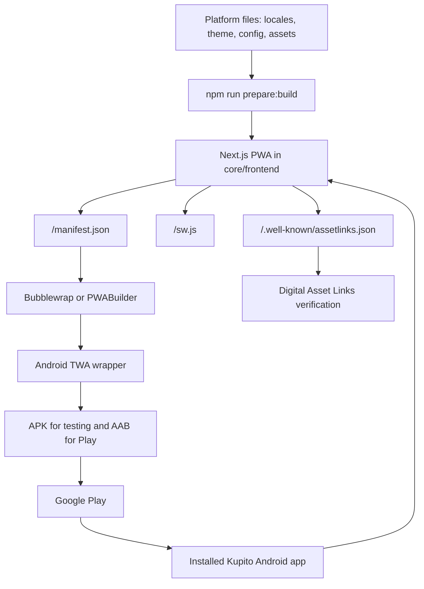

# Мобильное приложение kupito.club через PWA + TWA

Kupito.club публикует Android-приложение как Trusted Web Activity поверх существующей PWA: один продукт в вебе, тонкая Android-обёртка в platform repo для Google Play.

## 1. Решение

Базовая цепочка:

```text
Next.js site -> PWA -> Bubblewrap/PWABuilder -> Android TWA -> Google Play
```

TWA открывает `https://kupito.club` в fullscreen-режиме через браузер пользователя, а не через обычный WebView. Связь между Android-приложением и доменом подтверждается через Digital Asset Links.

Для kupito.club это лучший первый релиз мобильного приложения, потому что:

- весь продукт уже живёт в вебе: поиск авто, фильтры, объявления, избранное, сравнение, профиль и создание объявлений;
- не нужно дублировать UI, роутинг, авторизацию, i18n и бизнес-логику в отдельном нативном клиенте;
- большинство изменений сайта будут попадать в приложение без релиза в Google Play;
- Google поддерживает TWA как официальный способ публиковать PWA в Android-экосистеме;
- приложение не выглядит как пустая обёртка, потому что сайт уже имеет полноценную мобильную функциональность.

## 2. Границы решения

Что делаем:

- доводим текущий Next.js frontend до корректной PWA;
- создаём Android TWA wrapper для домена `kupito.club`;
- публикуем `.aab` в Google Play;
- добавляем `/.well-known/assetlinks.json` для верификации домена и Android package;
- после публикации обновляем web CTA “Мобильное приложение”, чтобы Android-пользователи попадали в Google Play.

Что не делаем на первом этапе:

- не используем WebView converter;
- не делаем отдельный iOS-клиент;
- не добавляем нативные фичи до успешного Android-релиза.

iOS на первом этапе остаётся обычной PWA-установкой через Safari. Отдельное iOS-решение нужно принимать позже, потому что TWA является Android-подходом.

### Ограничения TWA

- TWA работает через браузер пользователя. На Android основной целевой вариант — Chrome 72+ или другой браузер с поддержкой Trusted Web Activity.
- Если verification не проходит, пользователь увидит fallback Custom Tab с browser UI.
- Android wrapper не имеет прямого доступа к cookies, `localStorage` и DOM сайта.
- Любая нативная функция должна добавляться отдельно и только если она действительно нужна продукту.
- Для первого релиза все критичные сценарии должны быть полезны и доступны в обычном браузере, потому что TWA открывает тот же production site.

## 3. Архитектура



Ключевой принцип: приложение остаётся сайтом. Android wrapper должен быть максимально тонким и стабильным, а основная разработка продолжает идти в `core/frontend`.

## 4. Текущее состояние PWA

В проекте уже есть PWA-фундамент:

- `core/frontend/app/manifest.ts` генерирует web app manifest.
- `core/frontend/public/sw.js` содержит service worker.
- `core/frontend/components/pwa/ServiceWorkerRegistration.tsx` регистрирует service worker в production и показывает update prompt.
- `core/frontend/app/offline/page.tsx` содержит offline fallback page.
- `core/frontend/components/pwa/PWAInstallButtonGray.tsx` показывает текущую кнопку установки PWA.
- `core/frontend/hooks/usePWAInstall.ts` обрабатывает `beforeinstallprompt`, installed app detection (`standalone`, `fullscreen`, TWA referrer) и iOS-инструкции.
- `locales/{en,ro,ru}.json` содержат секцию `pwa`.

Текущий manifest уже задаёт:

- `start_url: '/'`;
- `display: 'standalone'`;
- `background_color` из `theme.pwa.backgroundColor`;
- `theme_color` из `theme.pwa.themeColor`;
- иконки `192x192` и `512x512`;
- `purpose: 'any'` и `purpose: 'maskable'`.

Перед TWA-релизом это нужно не переписать с нуля, а проверить и усилить.

## 5. PWA checklist перед TWA

Минимум для релиза:

- `https://kupito.club/manifest.json` доступен в production без редиректов и ошибок.
- `https://kupito.club/sw.js` доступен в production.
- Service worker регистрируется только в production и не ломает навигацию.
- Offline fallback открывается при потере сети.
- Главные мобильные сценарии работают на HTTPS:
  - открыть главную;
  - найти авто;
  - применить фильтры;
  - открыть объявление;
  - авторизоваться;
  - добавить в избранное;
  - открыть профиль;
  - создать объявление;
  - загрузить фото.
- Manifest содержит корректные `name`, `short_name`, `description`, `start_url`, `display`, `theme_color`, `background_color`, `icons`.
- Иконка `512x512` действительно квадратная, без прозрачных полей, и подходит для launcher icon.
- Maskable icon проверена через maskable icon preview.
- Lighthouse/PWA audit не показывает блокирующих проблем.
- В Chrome на Android сайт можно установить как PWA.

Проверки:

```bash
npm run prepare:build
cd core/frontend
npm run build
```

После деплоя production:

```bash
bubblewrap validate --url=https://kupito.club
```

Если `bubblewrap validate` показывает PWA-проблемы, сначала исправляем сайт, потом возвращаемся к Android wrapper.

## 6. Иконки и ассеты

Источник истины для платформенных ассетов находится в корне platform repo:

```text
assets/frontend/public/
```

Во время `npm run prepare:build` ассеты копируются в:

```text
core/frontend/public/
```

Для TWA нужно убедиться, что в source assets есть production-ready файлы:

- `pwa192.png`;
- `logo.png` или отдельная `pwa512.png`/launcher icon 512x512;
- maskable icon без важных деталей у краёв;
- screenshots для Google Play;
- feature graphic для Google Play;
- при необходимости отдельные store-ассеты в `assets/mobile/android/`.

Если добавляется новый public asset, его нужно добавлять в root `assets/`, а не напрямую в `core/frontend/public/`.

Рекомендуемая структура для store-материалов:

```text
assets/
  mobile/
    android/
      icon-512.png
      feature-graphic.png
      screenshots/
        phone-01.png
        phone-02.png
        phone-03.png
```

Store-ассеты не обязаны копироваться в `core/frontend/public/`, если они используются только для Google Play Console.

## 7. Где хранить TWA wrapper

TWA wrapper привязан к конкретной платформе:

- домен: `kupito.club`;
- package name;
- signing key;
- Google Play listing;
- production URL;
- store assets.

Поэтому базовая рекомендация для kupito.club: хранить Android wrapper в platform repo, а не в `core/`.

Рекомендуемый путь:

```text
android/twa/
```

Внутри будет обычный Android-проект, сгенерированный Bubblewrap:

```text
android/twa/
  twa-manifest.json
  build.gradle
  app/
  gradle/
  gradlew
  gradlew.bat
```

Если позже появится несколько платформ с одинаковым TWA-подходом, можно вынести общий шаблон или инструкцию в `core/docs`, но package/signing/store-конфигурация всё равно останется платформенной.

## 8. Package name и URL

Рекомендуемые значения для первого Android-релиза:

```text
Application name: Kupito
Package name: club.kupito.app
Host: kupito.club
Start URL: https://kupito.club/
Manifest URL: https://kupito.club/manifest.json
Display mode: standalone или fullscreen
Fallback: customtabs
```

Package name нельзя менять после публикации в Google Play без выпуска нового приложения. Перед созданием Play Console app нужно финально подтвердить `club.kupito.app`.

`fallbackType` должен оставаться `customtabs`, а не `webview`. Если TWA verification не проходит, лучше увидеть Custom Tab с browser UI и исправить Digital Asset Links, чем скрывать проблему WebView fallback.

## 9. Bubblewrap workflow

Bubblewrap является основным вариантом, потому что он даёт контролируемый Android-проект и воспроизводимые команды.

Установка:

```bash
npm i -g @bubblewrap/cli
```

Проверка окружения:

```bash
bubblewrap doctor
```

Инициализация проекта:

```bash
mkdir -p android/twa
cd android/twa
bubblewrap init --manifest=https://kupito.club/manifest.json
```

Во время `init` проверить:

- `name`: `Kupito`;
- `launcherName`: `Kupito`;
- `packageId`: `club.kupito.app`;
- `host`: `kupito.club`;
- `startUrl`: `/`;
- `themeColor` и `backgroundColor` соответствуют `theme/colors.ts`;
- icon URL указывает на production 512x512 icon;
- maskable icon URL задан, если есть отдельная maskable icon;
- orientation: portrait;
- fallback: custom tabs.

Сборка:

```bash
cd android/twa
bubblewrap build
```

Ожидаемые артефакты:

```text
android/twa/app-release-signed.apk
android/twa/app-release-bundle.aab
```

Назначение:

- `.apk` используется для ручного теста на устройстве;
- `.aab` загружается в Google Play Console.

Установка на устройство:

```bash
cd android/twa
bubblewrap install
```

или:

```bash
adb install app-release-signed.apk
```

## 10. PWABuilder workflow

PWABuilder можно использовать как быстрый no-code вариант или как sanity check для manifest/PWA readiness.

Использование:

1. Открыть `https://www.pwabuilder.com/`.
2. Ввести `https://kupito.club`.
3. Проверить PWA score и warnings.
4. Сгенерировать Android package.
5. Сверить package name, icons, colors, start URL и signing flow.

Если PWABuilder и Bubblewrap дают разные предупреждения, приоритет для реализации должен быть у Bubblewrap, потому что проект будет воспроизводимо собираться из CLI.

## 11. Digital Asset Links

Digital Asset Links связывает сайт и Android-приложение. Без него TWA verification не пройдёт, и приложение может открыться как Custom Tab с browser UI.

Файл должен быть доступен строго по адресу:

```text
https://kupito.club/.well-known/assetlinks.json
```

Source-of-truth путь в platform repo:

```text
assets/frontend/public/.well-known/assetlinks.json
```

После `npm run prepare:build` файл должен появиться здесь:

```text
core/frontend/public/.well-known/assetlinks.json
```

Формат:

```json
[
  {
    "relation": ["delegate_permission/common.handle_all_urls"],
    "target": {
      "namespace": "android_app",
      "package_name": "club.kupito.app",
      "sha256_cert_fingerprints": [
        "AA:BB:CC:DD:EE:FF:00:11:22:33:44:55:66:77:88:99:AA:BB:CC:DD:EE:FF:00:11:22:33:44:55:66:77:88:99"
      ]
    }
  }
]
```

Fingerprint в примере является placeholder. Его нельзя коммитить как реальное значение.

## 12. Signing keys и fingerprints

Самая частая причина провала TWA verification: в `assetlinks.json` указан не тот SHA-256 fingerprint.

Нужно различать:

- local/debug key, которым подписан тестовый APK;
- upload key, которым загружается `.aab` в Google Play;
- app signing key, которым Google Play подписывает приложение для пользователей.

Для локального теста можно временно добавить fingerprint локального ключа. Для production нужно добавить fingerprint Google Play App Signing certificate.

После создания приложения в Play Console:

1. Открыть Play Console.
2. Перейти в app signing / app integrity.
3. Найти SHA-256 certificate fingerprint для App signing key certificate.
4. Добавить этот fingerprint в `assetlinks.json`.
5. Запустить `npm run prepare:build`.
6. Задеплоить frontend.
7. Проверить `https://kupito.club/.well-known/assetlinks.json`.

Bubblewrap умеет работать с fingerprints:

```bash
cd android/twa
bubblewrap fingerprint list
bubblewrap fingerprint add "AA:BB:CC:DD:EE:FF:00:11:22:33:44:55:66:77:88:99:AA:BB:CC:DD:EE:FF:00:11:22:33:44:55:66:77:88:99"
bubblewrap fingerprint generateAssetLinks --output=assetlinks.json
```

Перед копированием результата в `assets/frontend/public/.well-known/assetlinks.json` нужно проверить JSON вручную и оставить только нужные production fingerprints.

## 13. Проверка TWA verification

На устройстве:

```bash
adb logcat -v brief | grep -e TWAProviderPicker -e cr_TrustedWebActivity
```

Ожидаемое поведение:

- приложение открывается fullscreen;
- нет верхней browser toolbar;
- переходы внутри `kupito.club` остаются внутри приложения;
- внешние ссылки уходят во внешний браузер или Custom Tab;
- при offline состоянии показывается существующий offline fallback;
- авторизация и cookies работают как в Chrome, потому что TWA использует browser runtime.

Если появляется browser toolbar:

1. Проверить, что `assetlinks.json` доступен по production URL.
2. Проверить `Content-Type` и отсутствие HTML-страницы вместо JSON.
3. Проверить package name.
4. Проверить SHA-256 fingerprint.
5. Проверить, что установленный build подписан тем ключом, fingerprint которого указан в `assetlinks.json`.
6. Переустановить приложение после исправлений.

## 14. Google Play checklist

Для Google Play Console понадобятся:

- Google Play Developer account;
- package name `club.kupito.app`;
- `.aab` файл из Bubblewrap;
- название приложения;
- короткое описание;
- полное описание;
- app icon;
- feature graphic;
- phone screenshots;
- privacy policy URL;
- Data safety form;
- content rating questionnaire;
- target audience;
- contact email;
- support URL или сайт;
- staged rollout plan.

Перед отправкой на review проверить:

- приложение стабильно запускается;
- главная страница не пустая;
- основные сценарии работают на мобильном экране;
- нет broken links в ключевых потоках;
- login и profile flow не ломаются внутри TWA;
- загрузка фото не блокируется Android permissions или browser limitations;
- cookie consent и legal links доступны;
- privacy policy соответствует фактическому сбору данных;
- Data safety form соответствует analytics/auth/listing/photo flows.

Google Play не принимает приложения с ограниченной полезностью, broken functionality или пустой оболочкой. Kupito проходит базовую продуктовую проверку за счёт реальной marketplace-функциональности, но wrapper должен быть стабильным и отзывчивым.

## 15. Что обновляется без Google Play релиза

Через обычный web deploy обновляются:

- UI;
- страницы;
- фильтры;
- карточки объявлений;
- поиск;
- профиль;
- создание объявлений;
- переводы;
- SEO/metadata сайта;
- AI или партнёрские функции;
- service worker logic;
- offline fallback.

Новый Android release нужен, если меняются:

- package name;
- app name в Android manifest;
- launcher icon;
- splash screen;
- signing config;
- Android permissions;
- intent filters;
- supported origins;
- TWA display mode;
- notification delegation;
- native Android integrations;
- target SDK или Android dependencies.

## 16. Web CTA после публикации

Текущая кнопка находится в:

```text
core/frontend/components/pwa/PWAInstallButtonGray.tsx
```

Сейчас она показывает PWA-install flow. После появления Google Play URL нужно изменить поведение:

- Android mobile: открыть Google Play listing;
- iOS mobile: оставить PWA-инструкции;
- desktop: показать modal с QR code и кнопкой Google Play;
- если Google Play URL выключен или отсутствует: оставить текущие PWA-инструкции.

Рекомендуемая platform config секция:

```typescript
mobileApp: {
  enabled: true,
  androidUrl: 'https://play.google.com/store/apps/details?id=club.kupito.app',
  iosUrl: null,
}
```

Для этого нужно будет расширить:

- `site-config.ts`;
- `config/site.ts`;
- `core/frontend/lib/site-config.ts`;
- компоненты CTA в `core/frontend/components/pwa/`;
- root `locales/en.json`, `locales/ro.json`, `locales/ru.json`.

После изменения root config/locales обязательно:

```bash
npm run prepare:build
```

Нельзя править copied locales напрямую в `core/frontend/lib/locales/`.

## 17. Deep links и scope

На первом релизе TWA открывает основной origin:

```text
https://kupito.club/
```

Все внутренние ссылки в пределах `kupito.club` должны оставаться внутри приложения. Внешние партнёрские ссылки должны открываться вне TWA или как Custom Tab, чтобы пользователь видел переход на другой домен.

Если позже нужно удерживать fullscreen для дополнительных owned origins, их можно добавить как `additionalTrustedOrigins`, но только после настройки Digital Asset Links на каждом origin.

Для первого релиза не добавлять лишние origins.

## 18. Push и permissions

Push-уведомления не являются обязательными для первого TWA-релиза.

Причина: push потребует отдельного продуктового и legal review:

- какие события отправляем;
- как пользователь подписывается и отписывается;
- какие данные передаются в push provider;
- как это отражается в Privacy Policy и Data safety;
- как хранить push subscription/device token.

Фаза после production-релиза:

- web push или notification delegation через TWA;
- backend endpoint для подписок;
- пользовательские настройки уведомлений;
- обновление legal и Data safety;
- отдельные тесты permission flow.

## 19. Legal и Data safety

Сам переход на TWA не должен менять сбор данных, если приложение просто открывает существующий сайт.

Перед публикацией в Google Play всё равно нужно проверить:

- privacy policy URL доступен публично;
- в legal text описаны auth, listings, photos, analytics, cookies и партнёрские переходы;
- Data safety form совпадает с фактическим поведением сайта;
- Google Play listing не обещает функций, которых нет в production;
- screenshots не показывают фейковые данные или недоступные функции.

Если добавляются push, native share, file handling, geolocation или новые analytics SDK, нужно отдельно пересмотреть `config/legal.ts`.

## 20. Фазы реализации

### Phase 0: PWA audit

Цель: убедиться, что production site готов быть основой приложения.

Работы:

- проверить `https://kupito.club/manifest.json`;
- проверить `https://kupito.club/sw.js`;
- проверить installability в Chrome Android;
- прогнать Lighthouse/PWA audit;
- прогнать `bubblewrap validate --url=https://kupito.club`;
- проверить мобильные сценарии каталога, объявления, auth, profile, создание объявления и загрузку фото;
- подготовить production-ready launcher/maskable icons.

Результат: список PWA blockers закрыт, сайт можно безопасно оборачивать в TWA.

### Phase 1: TWA prototype

Цель: получить первый APK для ручного тестирования.

Работы:

- создать `android/twa/`;
- запустить `bubblewrap init --manifest=https://kupito.club/manifest.json`;
- подтвердить `club.kupito.app`;
- собрать `app-release-signed.apk`;
- установить APK на Android device;
- проверить, что приложение открывает сайт и основные flows работают.

Результат: test APK запускается и показывает Kupito.

### Phase 2: Digital Asset Links и Internal testing

Цель: добиться trusted fullscreen TWA и загрузить первый `.aab` в Internal testing.

Работы:

- создать приложение в Play Console;
- получить App signing SHA-256 fingerprint;
- добавить `assets/frontend/public/.well-known/assetlinks.json`;
- выполнить `npm run prepare:build`;
- задеплоить frontend;
- проверить production `/.well-known/assetlinks.json`;
- собрать `app-release-bundle.aab`;
- загрузить `.aab` в Internal testing;
- установить приложение через Play testing track;
- проверить TWA verification на build из Play.

Результат: Internal testing build открывается fullscreen без browser toolbar.

### Phase 3: Production rollout

Цель: публичный релиз Android-приложения в Google Play.

Работы:

- подготовить screenshots и feature graphic;
- заполнить description, Data safety, content rating и contact details;
- проверить legal/privacy policy;
- пройти review;
- запустить staged rollout;
- мониторить Play Console vitals, отзывы, frontend errors и conversion на мобильных сценариях;
- после появления listing URL обновить web CTA.

Результат: Android-приложение доступно пользователям из Google Play.

### Phase 4: Улучшения после релиза

Возможные улучшения:

- Android app install CTA с QR на desktop;
- Web Share Target для публикации ссылок в Kupito;
- file handling или улучшенный photo upload flow;
- push-уведомления;
- richer offline для сохранённых объявлений;
- deeplink routing на объявления;
- app shortcuts для поиска, избранного и создания объявления;
- отдельная стратегия для iOS.

Эти улучшения делать только после стабильного Android production-релиза.

## 21. Release checklist

Перед merge изменений, связанных с TWA:

- root assets обновлены в `assets/`, а не напрямую в `core/frontend/public/`;
- если добавлен `assetlinks.json`, он лежит в `assets/frontend/public/.well-known/assetlinks.json`;
- после root assets/config/locales изменений выполнен `npm run prepare:build`;
- `core/frontend/app/manifest.ts` не содержит временных URL;
- package name в docs, `twa-manifest.json`, Play Console и `assetlinks.json` совпадает;
- SHA-256 fingerprint соответствует нужному signing key;
- не закоммичены keystore-файлы, passwords или service account JSON;
- Google Play URL добавлен в config только после реального listing URL;
- UI-тексты добавлены во все root frontend locales;
- docs не обещают iOS/native фичи как уже реализованные.

## 22. Секреты и файлы, которые нельзя коммитить

Нельзя коммитить:

- keystore passwords;
- private keys;
- Play Console service account JSON;
- локальные `.jks`/`.keystore`, если они не управляются отдельной согласованной secure-процедурой;
- `.env` с signing credentials;
- temporary APK/AAB artifacts, если они не нужны как release artifacts.

Нужно добавить или проверить `.gitignore` для Android wrapper перед первым коммитом `android/twa/`.

## 23. Источники

- [Android Developers: Trusted Web Activities](https://developer.android.com/develop/ui/views/layout/webapps/trusted-web-activities)
- [Chrome Developers: Trusted Web Activity quick start](https://developer.chrome.com/docs/android/trusted-web-activity/quick-start)
- [Bubblewrap CLI README](https://github.com/GoogleChromeLabs/bubblewrap/tree/main/packages/cli)
- [Digital Asset Links documentation](https://developers.google.com/digital-asset-links/v1/getting-started)
- [Google Play policy: Functionality, Content, and User Experience](https://support.google.com/googleplay/android-developer/answer/9898783?hl=en)
